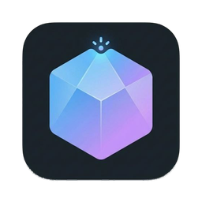

<p align="center">
  
</p>

<h1 align="center">ColimaUI</h1>

<p align="center">
  A native desktop GUI & local CLI control plane for <a href="https://github.com/abiosoft/colima">Colima</a> — manage Docker containers, Kubernetes clusters, Linux VMs, security audits, and AI workflows from a fast dark-themed interface.
</p>

<p align="center">
  <a href="https://github.com/vnknowledge2014/colima-ui/releases/latest"></a>
  <a href="https://github.com/vnknowledge2014/colima-ui/actions/workflows/ci.yml"></a>
  
  
  
  
  <a href="https://github.com/vnknowledge2014/colima-ui/blob/main/LICENSE"></a>
</p>

---

## 📥 Download

Grab the latest release from [**GitHub Releases**](https://github.com/vnknowledge2014/colima-ui/releases/latest):

| Platform | File | Architecture |
|----------|------|--------------|
| **macOS** (Apple Silicon) | `ColimaUI_*_aarch64.dmg` | M1 / M2 / M3 / M4 |
| **macOS** (Intel) | `ColimaUI_*_x64.dmg` | x86_64 |
| **Linux** (Debian/Ubuntu) | `ColimaUI_*_amd64.deb` | x86_64 |
| **Linux** (Universal) | `ColimaUI_*_amd64.AppImage` | x86_64 |

> **macOS Gatekeeper:** Pre-built DMGs are currently unsigned. If macOS shows
> *"ColimaUI.app is damaged and can't be opened"*, open **System Settings →
> Privacy & Security** and click **Open Anyway**, or run
> `xattr -cr /Applications/ColimaUI.app` after dragging the app to Applications.
> This removes the download quarantine flag and is only needed for downloaded
> builds, not locally compiled apps.

> **Local API & Dev Browser Mode:** Port `11420` (fallback `11420–11429`) hosts
> the **Bearer-authenticated REST & SSE API** used by the `cui` CLI and local AI
> agents via `~/.colima-ui/api_token` (`0600` permissions; paired with
> `~/.colima-ui/api_port`). Release builds serve no static web frontend on
> `:11420`. **Browser UI mode** is a development surface at
> `http://localhost:1420/#token=<token>` printed to stdout by `npm run tauri dev`.

---

## ✨ Features

| Pillar | Capabilities |
|--------|--------------|
| **Command Center AI** | Multi-provider agent (**9 providers**: Ollama, OpenAI, Anthropic, Google Gemini, OpenRouter, Groq, Together, Mistral, DeepSeek) with bracket-tag Event Bus tools, `<think>` reasoning blocks, **3-tier guided UX** (context-aware empty state, interactive choice cards, follow-up chips), safe Terminal command handoff, and multi-conversation SQLite history |
| **Security & Runtime Auditing** | Local Trivy vulnerability scanning with provenance-backed scores, CycloneDX/SPDX SBOM export, configuration rule pack (`L1`–`L3`), local base-image alternatives catalog, Falco runtime event stream, and isolated container Detonation sandbox |
| **Topology, Live Activity & Self-Healing** | Interactive Docker & Kubernetes topology graphs, low-overhead Bollard live metrics, alert rules with historical backtesting, self-healing rules with kill switch, Compose Diagnose & AI Autofix (preview/apply/undo), and background TAR/file transfers |
| **100% Free & Open Source (MIT)** | All features unlocked out of the box with zero account or sign-in required and strict BYOK local-first privacy |

### 🐳 Docker & Compose
- **Containers, Images, Volumes & Networks** — Full lifecycle CRUD, batch prune, real-time logs, stats, inspect, exec, and background image TAR export/import + container file copy (`cp`)
- **Compose Diagnose & Autofix** — Project start/stop/restart/logs plus YAML schema diagnosis and previewable, undoable autofix patches
- **Colima Instance & YAML Config** — Fast `<1ms` `~/.colima` config reader, diff preview & mtime-guarded `colima.yaml` apply, resource presets, and idle Resource Saver daemon

### ☸️ Kubernetes & Linux VMs
- **Multi-resource K8s browser & CRDs** — Pods, Deployments, Services, ConfigMaps, Secrets, StatefulSets, DaemonSets, Jobs, CronJobs, Ingresses, PVCs, Namespaces, Nodes, Events, and dynamic CRD discovery
- **Operations & Cluster Health** — Live SSE pod log streaming, `kubectl` apply/scale/restart, port forwarding, real PTY pod exec, HTTP service benchmarking (p50/p95/p99), X-Ray diagnostics, and Kind cluster lifecycle
- **Lima Linux VMs** — Template-based VM creation with custom CPU/memory/disk, lifecycle controls, and integrated PTY SSH tabs

### 📊 Desktop Experience
- Real pseudo-terminal (`portable-pty` + `xterm.js`) over Tauri IPC with per-profile shell history
- Offline full-text searchable Help Center (`articles_fts`) and full UI localization across **4 languages** (`en`, `ja`, `vi`, `zh`)

---

## 🚀 Getting Started

### Prerequisites

- **[Node.js](https://nodejs.org/) ≥ 22.22.2** (`npm`) — Frontend build and test suite (`.nvmrc` pins the line required by `jsdom`/`undici`)
- **[Rust](https://www.rust-lang.org/tools/install)** (stable) — Tauri backend and CLI binaries
- **[Colima](https://github.com/abiosoft/colima)** & **[Docker CLI](https://docs.docker.com/engine/install/)** — Container runtime & client
- *Optional:* **[kubectl](https://kubernetes.io/docs/tasks/tools/)**, **[Kind](https://kind.sigs.k8s.io/)**, **[Trivy](https://trivy.dev/)** (image scanning), **[Ollama](https://ollama.com/)** (local AI models)

### Development

```bash
git clone https://github.com/vnknowledge2014/colima-ui.git
cd colima-ui
npm install          # Installs dependencies and configures .githooks

# Desktop app (Tauri native window + Vite dev server + Browser mode URL)
npm run tauri dev

# Frontend-only Vite dev server (http://localhost:1420)
npm run dev
```

### Lint & Quality Gates

The repository enforces strict dead-code, token, and i18n checks on every push (`.githooks/pre-push`, mirrored by `.github/workflows/ci.yml`):

```bash
npm run lint          # ESLint: dead code, unused vars/imports, error-prone patterns
npm run typecheck     # TypeScript (tsc --noEmit)
npm run check         # Svelte type & template check (svelte-check)
npm run check:tokens  # Verify every CSS var() references a defined token
npm run check:i18n    # Verify all 4 locales (en, ja, vi, zh) carry identical keys
npm test              # Unit & component tests (Vitest)
npm run lint:rust     # cargo clippy --all-targets --all-features -- -D warnings
```

CI additionally runs `cargo test --manifest-path src-tauri/Cargo.toml --lib`. Rust integration tests requiring a live Docker daemon or Trivy are marked `#[ignore]`; run them explicitly with `cargo test --manifest-path src-tauri/Cargo.toml -- --ignored`.

### Production Build

```bash
# Local macOS .app bundle without an updater signing private key
npx tauri build --bundles app --config '{"bundle":{"createUpdaterArtifacts":false}}'

# Signed release bundle (when TAURI_SIGNING_PRIVATE_KEY is set)
npm run tauri build

# Frontend static bundle → dist/
npm run build
```

See [`docs/setup.md`](docs/setup.md) for Linux system packages, standalone CLI builds (`cui` / `colimaui`), and release signing variables.

---

## 🛠️ Tech Stack

| Layer | Technology | Version |
|-------|-----------|---------|
| **Frontend** | Svelte 5 (Runes) | 5.57 |
| **Language** | TypeScript | 6.0 |
| **Bundler** | Vite | 8.x |
| **Desktop** | Tauri | 2.x |
| **Backend** | Rust (Edition 2021) | — |
| **HTTP Server** | Axum | 0.8 |
| **Docker Client** | Bollard | 0.21 |
| **Terminal** | xterm.js + portable-pty | 6.0 / 0.9 |
| **Database** | SQLite (rusqlite + FTS5) | 0.40 |
| **Styling** | Vanilla CSS (token design system) | — |

---

## 📁 Project Structure

```
colima-ui/
├── src/                          # Frontend (Svelte 5 + TypeScript)
│   ├── App.svelte                # Main shell, sidebar, event listeners
│   ├── main.ts                   # Entry point
│   ├── pages/                    # 19 .svelte page views
│   ├── components/               # Shared & domain UI components (ai/, security/, activity/, compose/, topology/, ...)
│   ├── store/                    # Svelte 5 rune-based state stores
│   ├── lib/                      # Dual-mode API client, Command Center AI core, Event Bus, i18n, utilities
│   ├── styles/                   # Modular CSS token design system
│   └── locales/                  # 4 languages (en, ja, vi, zh)
├── src-tauri/                    # Backend (Rust + Tauri v2)
│   ├── src/
│   │   ├── lib.rs                # App setup, state & Tauri IPC command registration
│   │   ├── api_server.rs         # Axum router & localhost HTTP/SSE server (11420–11429)
│   │   ├── auth.rs               # CSPRNG Bearer token, IPC & 0600 ~/.colima-ui/api_token handoff
│   │   ├── commands/             # 53 command modules (Docker, K8s, Colima, Security, Metrics, AI, KB, ...)
│   │   ├── routes/               # 26 HTTP route modules (thin delegation to commands/)
│   │   ├── adapters/             # Unified DevOps CLI adapter traits
│   │   ├── services/             # High-level orchestration layer
│   │   ├── telemetry/            # Opt-in closed-vocabulary telemetry & redaction
│   │   ├── bin/                  # Standalone CLI binaries (cui, colimaui)
│   │   ├── sse.rs                # SSE broadcast & topic subscriber tracking
│   │   ├── error.rs              # Structured ColimaError classification & remediation hints
│   │   ├── redact.rs             # Credential & secret redaction
│   │   ├── validation.rs         # Input & path-containment security checks
│   │   ├── docker_state.rs       # Bollard real-time container event stream
│   │   ├── instance_reader.rs    # Fast ~/.colima YAML config reader
│   │   └── terminal_session.rs   # Real PTY session manager (Tauri IPC)
│   └── tauri.conf.json           # Tauri bundle & capability configuration
├── scripts/                      # Git hook installer, token/i18n gates, release script
├── docs/                         # Technical documentation & setup runbook
└── external_skill/               # AI orchestration skill for external host agents
```

> See [`docs/`](docs/) for architecture, API, Command Center AI, security, and telemetry documentation.

---

## 🔄 CI/CD & Releases

- **CI** (`.github/workflows/ci.yml`) — ESLint, TypeScript, `svelte-check`, CSS token & i18n gates, Vitest unit suite, `cargo check` + `cargo clippy` (macOS ARM64/x86, Linux), `cargo test --lib`, and frontend build verification
- **Release** (`.github/workflows/release.yml`) — Builds DMG/deb/AppImage artifacts on version tags and publishes GitHub Releases

```bash
# Bump version, commit, tag, and push
./scripts/release.sh patch   # 0.2.0 → 0.2.1
./scripts/release.sh minor   # 0.2.0 → 0.3.0
./scripts/release.sh major   # 0.2.0 → 1.0.0
./scripts/release.sh 2.0.0   # explicit version
```

---

## 🤝 Contributing

1. Fork the repository
2. Create a feature branch (`git checkout -b feature/amazing-feature`)
3. Run the quality gates (`npm run lint && npm run typecheck && npm run check && npm test && npm run lint:rust`)
4. Commit your changes following [Conventional Commits](https://www.conventionalcommits.org/) and open a Pull Request

---

## 📄 License

MIT License — 100% free and open source. Part of the [Colima](https://github.com/abiosoft/colima) ecosystem.

<p align="center">
  Built with <a href="https://tauri.app">Tauri</a>, <a href="https://svelte.dev">Svelte</a>, and <a href="https://www.rust-lang.org">Rust</a>
</p>
