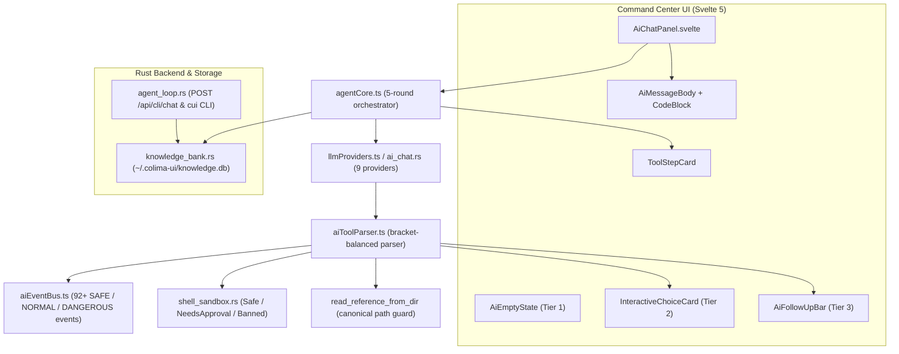

# Command Center AI

ColimaUI ships an integrated **Command Center AI** agent that inspects live system state, drives UI and backend operations through a typed App Event Bus, guides multi-step decisions with interactive cards, and persists multi-thread conversations and learned remedies locally in SQLite.

---

## Architecture Overview



### Core Layers

1. **Frontend Orchestrator (`src/lib/agentCore.ts`)** — Drives up to 5 reasoning rounds (`MAX_SEARCH_ROUNDS = 5`), injects Knowledge Bank matches and FTS5 memories, deduplicates repeated read-only tool calls across rounds (`normalizeToolCallKey`), and coordinates user approval promises without blocking panel minimize/restore.
2. **Bracket-Balanced Tag Parser (`src/lib/aiToolParser.ts`)** — Extracts `[TAG: payload]` and `[TAG: arg1 | arg2]` directives with full JSON string, escape, brace `{...}`, and bracket `[...]` depth tracking rather than fragile regexes or XML tags.
3. **App Event Bus (`src/lib/aiEventBus.ts` & `src/lib/aiEvents/`)** — Wraps **92 cataloged operations** (across `docker`, `colima`, `k8s`, `lima`, `compose`, `volumes`, `system`, and `config` modules) classified into three safety tiers:
   - `SAFE`: Read-only queries executed automatically via `[QUERY: ...]`.
   - `NORMAL`: State mutations gated behind `[EVENT_APPROVE: ...]` user confirmation.
   - `DANGEROUS`: Destructive or irreversible actions rendered with an explicit warning banner before approval.
4. **Multi-Provider Streaming Client (`src/lib/llmProviders.ts`, `src/lib/aiProviderConfig.ts`, `src-tauri/src/commands/ai_chat.rs`)** — Supports **9 provider ecosystems** (**Ollama**, **OpenAI**, **Anthropic**, **Google Gemini**, **OpenRouter**, **Groq**, **Together**, **Mistral**, and **DeepSeek**) across native Anthropic `/v1/messages`, OpenAI & OpenAI-compatible `/v1/chat/completions` gateways (with presets for LiteLLM, 9router, OpenRouter, Groq, vLLM/LM Studio), Gemini `:streamGenerateContent?alt=sse` (sending `x-goog-api-key` in headers, never URL query strings), and Ollama Local/Cloud `/api/chat`. Streaming chunks normalize native `thinking` / `reasoning_content` fields and inline tags into unified multi-packet `<think>...</think>` blocks, while `redact()` scrubs credentials from any surfaced HTTP error.
5. **Headless CLI Agent (`src-tauri/src/commands/agent_loop.rs` & `src-tauri/src/bin/cui.rs`)** — Exposes `POST /api/cli/chat` for the `cui` terminal client and external host orchestrators using `~/.colima-ui/api_token`.

---

## Context Optimization & Ground Truth

### Deterministic Core Prompt & User Plugins
`build_app_context_from_dir` (`src-tauri/src/commands/system.rs`, exposed via `get_app_context` IPC and `GET /api/ai/context`) deterministically loads exactly **3 bundled markdown files** instead of dumping every skill into every prompt:
1. `resources/system_prompt.md` — Core principles, terminology glossary, safety tiers, and bracket-tag syntax.
2. `resources/router.md` — Intent-to-reference routing table.
3. `resources/skills/colima_ui/SKILL.md` — Authoritative 92-event catalog and payload schemas.

If `~/.colima-ui/plugins.yaml` exists, custom user shortcuts are appended and mapped to `[EVENT_APPROVE: cli-exec | ...]`.

### On-Demand Reference Loading & Path Containment
When deeper domain rules are needed, the agent emits `[READ_REFERENCE: path/to/file.md]`. Both `read_reference` (Tauri IPC) and `GET /api/system/reference?path=...` call `read_reference_from_dir`, which:
- Strips optional leading `/` and `resources/` prefixes.
- Canonicalizes both the bundled `resources/` root and target path.
- Verifies `canon_target.starts_with(&canon_base)` and `canon_target.is_file()`, rejecting directory reads and `../` path traversal (`403 Forbidden`).

### Live UI Context Snapshot
When Live Context is enabled in `AiModelQuickBar.svelte`, `buildLiveUiContextSnapshot` (`src/lib/aiSuggestions.ts`) appends a compact `[LIVE_UI_CONTEXT]` block with the active UI tab, user locale, Colima instance states, running/stopped container counts, and Kubernetes connectivity so the agent prioritizes live screen state over stale chat turns.

### Payload & Token Hygiene
Before each LLM request, the payload assembly pipeline (`buildCleanConversationWindow` / `buildLlmPayload` in `src/lib/agentCore.ts`) enforces strict context hygiene:
- **Strip historical UI/tool tags (`stripHistoricalSuggestions` / `parseAiTools`)**: Removes old `[SUGGEST]`, `[ASK_CHOICE]`, `[QUERY]`, and `[EVENT_APPROVE]` tags from prior assistant turns so historical chips do not pollute future completions.
- **Head + tail tool pruning (`capToolOutput` / `truncateToolResult`)**: Caps oversized tool outputs at `5,120` chars for LLM context (`1,200` chars on UI step cards), keeping the first **80%** (headers/schema) and last **20%** (exit summaries/errors).
- **Round collapsing & deduplication (`collapseToolRounds` / `pendingSupersededStreamId`)**: Replaces preliminary assistant drafts on intermediate non-approval rounds, blocks duplicate `[QUERY]`/`[RUN]` calls via `normalizeToolCallKey` (cleared automatically after any approved state mutation), merges consecutive same-role messages, enforces a leading `role: "user"` turn (required by Anthropic), and appends a trailing continuation/formatting anchor after `[Tool Results]`.

---

## Tool Tag Reference

All directives use bracket-balanced colon syntax (`[TAG: ...]`) parsed by `src/lib/aiToolParser.ts`:

| Tag | Category | Behavior |
|-----|----------|----------|
| `[QUERY: eventName \| jsonPayload]` | Auto-run (`SAFE`) | Executes a `SAFE` Event Bus handler and feeds output into the next round |
| `[QUERY_APP_STATE]` | Auto-run (`SAFE`) | Reads host specs, Colima instances, container summaries, Compose projects, K8s context, and presets in parallel |
| `[EVENT_APPROVE: eventName \| jsonPayload]` | Approval (`NORMAL`/`DANGEROUS`) | Pauses on an inline `ToolStepCard` until the user clicks **Allow** or **Deny** (auto-runs if event is `SAFE`) |
| `[ASK_CHOICE: {...}]` / `[ASK_CHOICE: Q \| A \| B]` | Guided UX (Tier 2) | Renders `InteractiveChoiceCard` (JSON or pipe shorthand; `[multi]` prefix enables multi-select). Does not loop `hasTools` |
| `[SUGGEST: label \| prompt]` | Guided UX (Tier 3) | Renders up to 3 clickable `AiFollowUpBar` chips at the end of a turn |
| `[NAVIGATE: pageName]` | Auto-run (`SAFE`) | Switches the active ColimaUI view (`containers`, `kubernetes`, `security`, `topology`, etc.) |
| `[READ_REFERENCE: path]` | Auto-run (`SAFE`) | Loads bundled reference markdown inside `resources/` |
| `[DIAGNOSE]` | Auto-run (`SAFE`) | Collects Lima/Colima VM diagnostic logs (`ha.stderr.log`, `serial.log`, socket/lock checks) |
| `[RUN: command]` | Sandbox-gated | Runs through `shell_sandbox`; auto-executes if `Safe`, upgrades to inline approval if `NeedsApproval`, rejects if `Banned` |
| `[RUN_APPROVE: command]` | Approval (`DANGEROUS`) | Always prompts for explicit user approval before calling `sandbox_execute_approved` |
| `[SEARCH: query]` | Research | Queries SearXNG (with DuckDuckGo fallback) via `/api/ai/search` |
| `[SECURITY_THREAT_MODEL: dir \| mode]` | Approval (`NORMAL`) | Runs threat modeling (`interview`, `bootstrap`, `bootstrap-then-interview`) via `cli-exec` |
| `[SECURITY_VULN_SCAN: dir]` | Approval (`NORMAL`) | Runs directory vulnerability scan via `cli-exec` |
| `[SECURITY_TRIAGE: path]` | Approval (`NORMAL`) | Triages scan findings via `cli-exec` |
| `[SECURITY_PATCH_GEN: path \| repo]` | Approval (`DANGEROUS`) | Generates candidate security patches with diff warning |
| `[SCHEDULE_CRON: expr \| prompt]` | Session timer | Registers an in-session recurring check (max 3 active schedules; cleared on chat switch/stop) |
| `[SCHEDULE_TIMER: seconds \| prompt]` | Session timer | Schedules a one-shot prompt wakeup (`1–86400` seconds) |
| `[SCHEDULE_CANCEL: id]` | Session timer | Cancels an active timer or cron schedule |
| `[LEARN_REASONING: problem \| solution]` | Memory | Stores trajectory in `agent_memory` (`reasoning`) and upserts `solutions` |
| `[REMEMBER_PREFERENCE: preference]` | Memory | Stores user preference in `agent_memory` (`preference`) |

### Anti-Flicker & Prose Cleanup
- **`stripStreamingPartialTags(text)`**: Strips any unclosed trailing tool or `[SUGGEST]`/`[ASK_CHOICE]` tag (plus dangling backticks or empty list bullets right before it) on every streamed token while leaving standard Markdown `[label](url)` links intact.
- **`cleanToolSyntaxRemnants(text)`**: Fence-aware post-processor that splits prose from fenced ```` ``` ```` / `~~~` code blocks and removes empty `` ` ` `` pairs, orphaned bullet markers, and triple blank lines only outside code fences.

---

## Command Center UI & 3-Tier Guided UX

### 3-Tier Guided UX
1. **Tier 1 — Context-Aware Empty State (`src/components/ai/AiEmptyState.svelte`)**: Driven by `getStarterPrompts` (`src/lib/aiSuggestions.ts`). Inspects live store state to surface up to **2 warning starters** first (stopped Colima instances, exited/dead containers), followed by starters tailored to `uiState.currentPage` (up to 4 total), plus one-click local Ollama setup when unconfigured.
2. **Tier 2 — Consultant Mode Choice Cards (`src/components/ai/InteractiveChoiceCard.svelte`)**: Renders `[ASK_CHOICE]` prompts as keyboard-accessible single-select or multi-select option cards with descriptions, custom free-text input, composer **Insert**, and latest-turn locking so historical cards remain read-only summaries.
3. **Tier 3 — Follow-Up Suggestion Bar (`src/components/ai/AiFollowUpBar.svelte`)**: Displays up to 3 horizontal `[SUGGEST]` chips above the composer. When the model omits `[SUGGEST]` (and no choice card is active), `deriveFallbackSuggestions` synthesizes contextual next steps from the tools executed in that turn and the current page.

### Supporting Command Center Components
- **`ToolStepCard.svelte`** (`src/lib/aiToolStep.ts`): Unified in-place card for queries, Event Bus mutations, sandbox commands, diagnostics, security tasks, and navigation (`pending_approval` → `running` → `succeeded` / `failed` / `denied`), with collapsible JSON payload/output viewers and `SAFE` / `NORMAL` / `DANGEROUS` badges.
- **`AiMessageBody.svelte` & `chatMarkdown.ts`**: Custom XSS-sanitized Markdown AST renderer supporting streaming `<think>` disclosure blocks (auto-open with spinner while streaming, collapsible once complete), GFM aligned tables, and `CodeBlock.svelte`.
- **`CodeBlock.svelte` (Safe Terminal Handoff)**: Shell code blocks include Copy, Insert-into-chat, and **Terminal** handoff — which copies the snippet to the clipboard and opens an SSH terminal tab to the running Colima VM **without** appending `Enter` or auto-executing the command.
- **`AiModelQuickBar.svelte`**: Compact header bar for switching configured providers/models on the fly and toggling `[LIVE_UI_CONTEXT]`.
- **1-Touch Error Diagnostic Banner**: `AiChatPanel.svelte` subscribes to `onError` from `globalToast.ts`, surfacing recent redacted application errors as a one-click diagnostic banner (and unread badge count when the panel is minimized).

---

## Multi-Conversation Persistence, Memory & Sandbox

All persistent AI state lives in `~/.colima-ui/knowledge.db` (`0600` permissions inside `0700` `~/.colima-ui`).

### Multi-Conversation SQLite Schema
- **`chat_conversations`** (`id`, `title`, `created_at`, `updated_at`) — Thread metadata ordered by `updated_at DESC`, with automatic first-user-message preview fallback. Deleting the `"default"` conversation clears its messages while keeping the row intact.
- **`chat_messages`** (`id`, `role`, `content`, `created_at`, `conversation_id`) — Queried with `ORDER BY created_at ASC, rowid ASC` so user prompts, inline `ToolStepCard` system rows, and assistant replies always replay in exact visual turn order even when multiple rows share the same Unix-second timestamp. `rebuildAssistantTurnContent` preserves `[ASK_CHOICE]` and `[SUGGEST]` tags while stripping execution tags before saving.

### Knowledge Bank & Long-Term Memory (`knowledge_bank.rs`)
- **`solutions` & `anti_patterns`**: Seeded with 22+ builtin Colima/Lima/Docker failure remedies. Positive feedback up-ranks remedies; negative feedback records `anti_patterns` so failed advice is not repeated.
- **`agent_memory` & `agent_memory_fts` (FTS5)**: Full-text indexed store backing long-term reasoning trajectories (`type = 'reasoning'` / `reasoning_bank`), user preferences (`type = 'preference'` / `user_memory`), and learned facts (`type = 'learned'`), recalled automatically at the start of `runAgent`.

### 3-Tier Command Sandbox (`src-tauri/src/commands/shell_sandbox.rs`)
Raw shell commands go through deterministic Rust-level classification (`30s` timeout, `10 KB` output cap):
1. **`Safe` (Auto-execute)**: Read-only inspection prefixes (`docker ps`, `docker logs`, `docker inspect`, `docker context ls/show/inspect/list`, `colima status/list/version`, `limactl list/info`, `kubectl get/describe/logs/top`, `ps`, `df`, `lsof -i`, etc.).
2. **`NeedsApproval` (User confirmation required)**: State-changing prefixes (`colima start/stop/restart/delete`, `docker start/stop/rm/rmi/system prune`, `docker context use`, `docker compose up/down/restart`, `kubectl delete/apply/scale/rollout/config`, `brew install/upgrade/uninstall`, `pkill`/`kill`, `rm [-f] /var/run/docker.sock`), plus any `kubectl get` or `kubectl describe` targeting Kubernetes `secret`/`secrets`.
3. **`Banned` (Always rejected in Rust)**: Shell chaining and injection metacharacters (`;`, `` ` ``, `$`, `|`, `&`, `>`, `<`, `\n`, `&&`, `||`, `$(`, `${`), `sudo`, arbitrary `rm`, `chmod`/`chown`, `eval`/`exec`, subshells (`sh -c`, `bash -c`, `python -c`), `sed -i`, `mv`/`cp`, and `curl`/`sort` file-write or upload flags (`-o`, `-O`, `-T`, `-d`, `-F`, `-K`).
